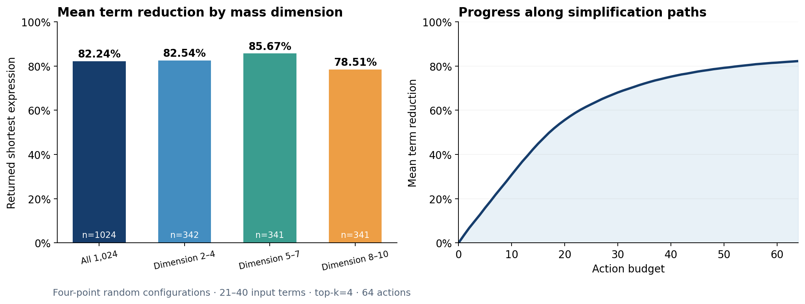
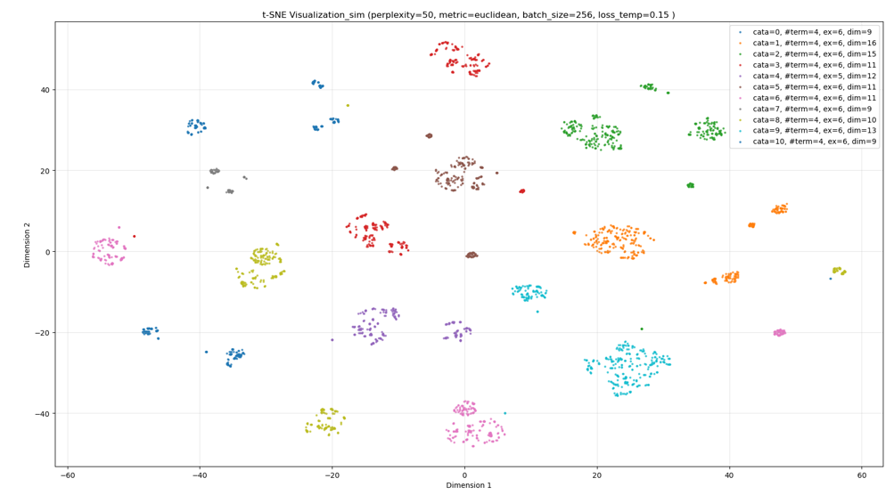
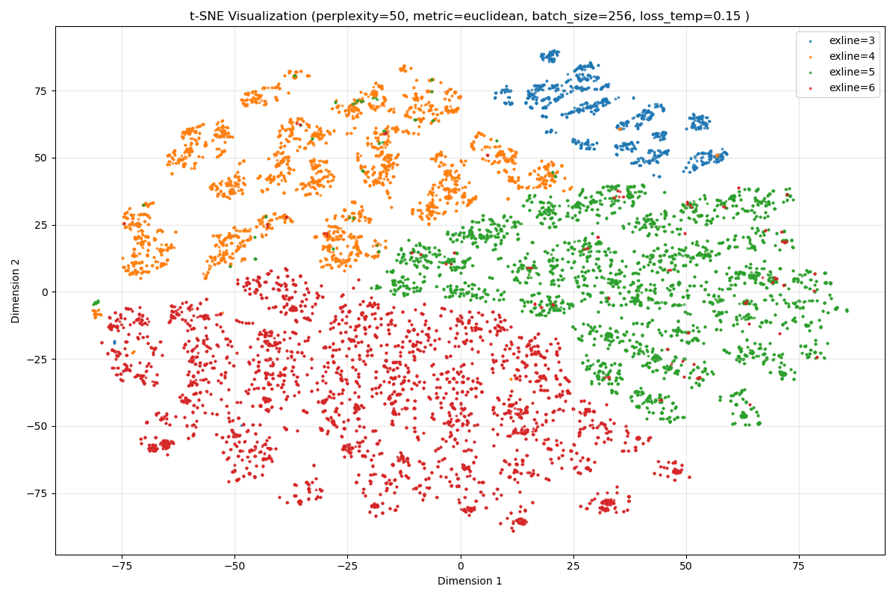
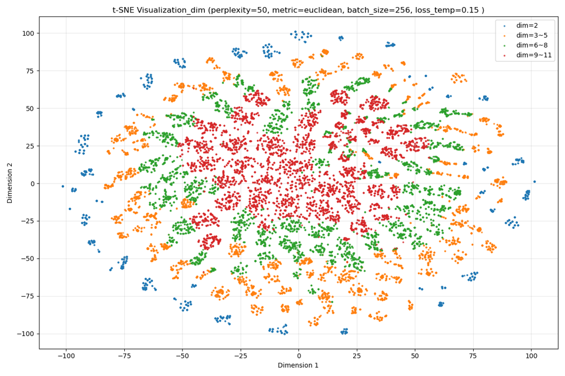

# 散射振幅的神经符号化简

**768维Transformer代数表示＋PPO强化学习＋精确符号运算。**

A neural-symbolic approach to scattering amplitude simplification: a pretrained Transformer learns algebraic representations, and a PPO policy selects valid symbolic transformations to produce shorter expressions.

## 项目背景

散射振幅计算中，同一个物理量可以写成许多外观不同的多项式。动量守恒与Schouten恒等式提供了等价变换，但如何组合这些变换、找到更紧凑的表达式，需要在大量候选操作中作出选择。

项目采用两阶段设计：先学习代数关系，再学习化简策略。**预训练encoder识别哪些项具有代数关联；PPO策略网络结合表达式上下文，对程序枚举的合法动作评分；符号引擎执行变换。**

## 四点振幅化简成果

在新生成的**1024条四点随机构型振幅**上，输入为21–40项，量纲≤10。策略采用top-k=4、最多64步，每个输入执行一条路径，并返回路径上项数最少的表达式。

| 量纲 | 输入数量 | 平均输入项数 | 平均输出项数 | 平均减项率 |
|---|---:|---:|---:|---:|
| 全部 | 1024 | 27.24 | 4.90 | **82.24%** |
| 2–4 | 342 | 22.77 | 3.97 | **82.54%** |
| 5–7 | 341 | 28.80 | 4.18 | **85.67%** |
| 8–10 | 341 | 30.15 | 6.56 | **78.51%** |

总体平均由**27.24项化简到4.90项，平均减项率82.24%**。全部输入合计27890项，返回结果合计5021项，总项数减少82.00%。



数据由不超过5项的原始振幅随机应用恒等式扰乱生成，同一表达式的各项保持统一量纲与螺旋度构型。三组量纲2–4、5–7、8–10分别342、341、341条；21项下限使第一组实际为量纲4。平均减项率采用每个输入等权统计。

[完整实验设置与结果](docs/RESULTS.md) · [1024条输入](datasets/fourpoint1024/test.json) · [逐输入结果](results/fourpoint1024.json) · [简历项目描述](docs/RESUME.md)

## 预训练encoder学到了什么

预训练采用768维、3层、8头、FFN3072的Transformer，结合可学习RoPE与监督对比损失。由恒等式联系的样本组成正样本组，token表示聚合并归一化后进入对比目标。

**代数关联样本聚类。** 相同来源的恒等式关联项在嵌入空间中形成簇，为后续策略提供结构化表示。



**物理结构也进入了表示。** 按外线数着色可看到不同区域，按量纲着色可看到由低到高的空间层次。

| 外线数 | 振幅量纲 |
|---|---|
|  |  |

可视化脚本支持通过命令行选择不同encoder并设置数据量，见[预训练可视化用法](docs/PRETRAIN_EVALUATION.md)。

## 强化学习如何化简

1. **构建合法动作集。** 程序从当前表达式中提取可应用恒等式的项与括号因子对。
2. **融合学习表示与代数特征。** 冻结768维encoder，结合括号指数、系数、外线数，经项间和项内Transformer形成上下文表示。
3. **学习动作价值。** 策略头为合法动作输出logits，价值头估计状态价值；使用PPO-Clip、GAE与熵正则训练。
4. **执行并保存更短式。** 符号引擎执行所选动作，策略允许暂时扩项以继续探索，推理结束后返回访问过的最短表达式。

策略与价值网络共约**361万可训练参数**；前置encoder在RL训练中保持冻结。奖励结合减项、分段效率、potential-based shaping和扩项惩罚，使用分量纲课程与旧课程回放学习随机构型。

[网络架构、张量形状与训练方法](docs/ARCHITECTURE.md)

## 快速使用

环境：Python 3.12、PyTorch 2.7.1。先安装适合本机的PyTorch版本，再安装其余依赖：

```powershell
python -m pip install -r requirements.txt
```

符号运算使用`forsythia_hep`，安装方式见[环境与复现说明](docs/SETUP.md)。安装与Python版本匹配的引擎后，可直接运行现场生成、现场扰乱、现场化简示例：

```powershell
python -B scripts/simplify_policy.py --policy artifacts/models/rl/policy_096.pt --n-point 4 --dimension 8 --initial-terms 5 --scramble-steps 32 --topk 4 --steps 64 --seed 103
```

也可以将自己的`SpExpr`传入Python接口：

```python
from scripts.simplify_policy import PolicySimplifier

solver = PolicySimplifier("artifacts/models/rl/policy_096.pt")
simplified = solver.simplify(expression, n_point=4, topk=4, budget_steps=64, seed=103)
```

## 代码导航

| 路径 | 内容 |
|---|---|
| `models/`、`training/`、`scripts/pretrain.py` | encoder结构、对比损失及预训练 |
| `data/generation.py` | 合法振幅构型与恒等式关联数据生成 |
| `project/rl/legal_actions.py` | 代数特征和合法动作表 |
| `project/rl/restricted_policy.py` | 策略网络、价值网络和允许的状态输入 |
| `project/rl/entropy20_policy.py` | PPO-Clip、价值损失和熵正则 |
| `scripts/simplify_policy.py` | 面向`SpExpr`的推理接口和命令行示例 |
| `scripts/evaluate_fourpoint.py` | 复现1024条固定输入的推理实验 |
| `graphs/`、`docs/`、`results/` | 预训练图、方法说明、实验结果 |

技术栈：Python、PyTorch、Transformer、监督对比学习、PPO、GAE、spinor-helicity、符号代数。
