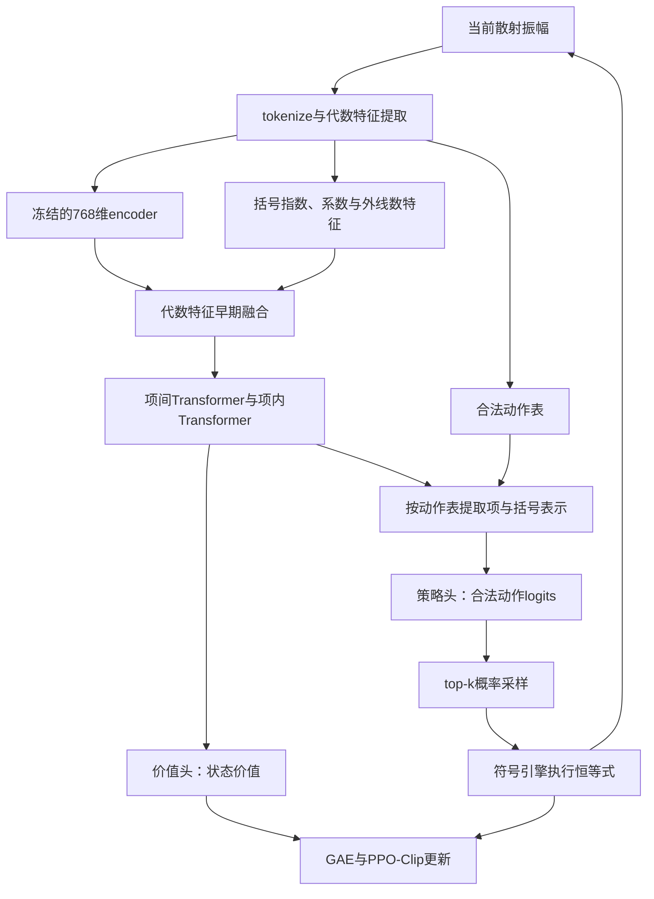

# 从代数表示到符号化简策略

本项目将散射振幅化简拆成两个学习问题：哪些项在代数上有关联，以及下一步应该对哪里应用恒等式。前者通过监督对比预训练学习，后者通过与符号引擎交互的PPO学习。

## 物理背景与问题建模

在spinor-helicity形式中，散射振幅由旋量括号`<ij>`和`[ij]`组成。动量守恒和Schouten恒等式让形式不同的表达式描述同一个振幅。逐次应用这些关系，可以把多项式改写为项数更少的形式。

化简需要兼顾局部选择和长期结果。某次变换可能暂时增加项数，随后才与其他项抵消；同一个表达式又可能有许多合法操作。这使它适合表示为序列决策问题：状态是当前表达式，动作是对某一项的某对括号应用恒等式，符号引擎给出下一状态。

数据生成按照外线粒子数、量纲与螺旋度构型生成单项式，再使用恒等式扰乱完整表达式。同一表达式内所有项的量纲和螺旋度一致。当前表示覆盖最多六点的30种规范旋量括号。

## 第一阶段：监督对比预训练

预训练模型以单项式的token序列为输入。token表示精确整数系数、括号种类、幂次及外线标签。模型使用可学习旋转位置编码RoPE的Transformer encoder，学习项内括号、幂次和外线标签之间的关系。

| 组件 | 配置或计算 |
|---|---|
| 隐藏维度 | 768 |
| Transformer层数 | 3 |
| 注意力头数 | 8 |
| 前馈网络隐藏维度 | 3072 |
| 位置编码 | 可学习RoPE |
| token表示聚合 | 有效token求和，再做L2归一化 |
| 学习目标 | 基于余弦相似度的监督对比损失，温度0.15 |

预训练样本以恒等式关联关系组成正样本组。损失函数将组内项的表示拉近，并利用同批次其他组的样本形成对比。经过训练，模型能够将代数上关联的项组织到相近区域，同时表示外线数、量纲等物理结构。

源码入口：`models/encoder.py`、`models/custom_encoder.py`和`models/rope_bias_*.py`定义网络；`training/loss.py`定义对比损失；`scripts/pretrain.py`组织训练；`data/generation.py`生成合法构型和恒等式关联数据。

## 第二阶段：冻结encoder的PPO策略学习

强化学习阶段保留预训练encoder的表示，训练其后的策略网络和价值网络。程序首先枚举结构合法的“项编号＋括号因子对”，网络对这些动作逐一打分，再交给符号引擎执行。



每项有32维代数特征：30种括号的幂次、系数符号、相对系数大小。再加上外线数one-hot，经MLP映射为64维，与encoder得到的512维项表示融合。项间Transformer学习跨项关系，项内Transformer产生256维token表示。

记`B`为批大小、`T`为项数、`S`为项内token数、`M`为所有样本合法动作的总数：

| 关键计算 | 输出形状 |
|---|---|
| 冻结encoder | `[B,T,S,768]` |
| token投影及归一化项聚合 | `[B,T,S,512]`、`[B,T,512]` |
| 代数特征MLP，35→64→64 | `[B,T,64]` |
| 融合及项间Transformer | `[B,T,512]` |
| 融合项上下文及项内Transformer | `[B,T,S,256]` |
| 按合法动作表读取项、全局和两个括号表示 | `[M,298]` |
| 策略MLP，298→64→32→1 | `[M]`，再按表达式补齐为`[B,A_max]` |
| 价值MLP，581→128→64→1 | `[B]` |

每个动作的298维输入由项摘要64维、全局摘要64维、括号对表示96维、动作代数特征69维，以及5维上下文组成。上下文包括外线数、当前项数和历史最小项数。两个括号的表示通过和、绝对差、逐元素积组合，形成对括号次序对称的动作表示。

encoder之后共3,606,435个可训练参数。预训练权重在PPO阶段保持冻结，策略和价值网络共同学习当前化简任务。

## 训练方法

训练采用PPO-Clip、GAE和actor–critic。策略在top-k条件softmax分布中采样一个动作；执行后接受容量范围内的后继，包括暂时扩项。各条轨迹分别计算GAE，再合并为固定mini-batch进行多轮更新。

奖励包括历史最小项数的改进、鼓励更早化简的分段奖励、基于encoder表示的potential-based reward shaping，以及随检查时刻增长的扩项惩罚。训练数据按四点和五点课程混合采样，持续学习新构型并复习已学构型。

```text
loss = PPO_clip_loss + 0.5 × value_MSE − 0.001 × entropy
```

展示模型使用GAE λ=0.93、γ=1、PPO clip=0.2、训练top-k=8。当前96轮模型在四点随机构型课程后，又经过60轮四/五点联合学习和36轮五点课程追加学习；后两阶段学习率为1e-4。每轮从数据集重新抽取初始振幅。随机扰乱用于构造输入，策略通过实际恒等式执行得到的奖励进行学习。

核心代码：`project/rl/legal_actions.py`负责动作枚举，`restricted_policy.py`负责actor–critic，`restricted_environment.py`负责奖励，`packed_ppo.py::compute_gae`负责优势估计，`entropy20_policy.py`负责含熵项的PPO更新。

## 推理接口

`scripts/simplify_policy.py::PolicySimplifier`加载一次模型，可重复处理多个`SpExpr`。输入包括表达式、外线数、topk和动作预算。每一步从策略概率中选择一个动作，维护访问过的最短表达式，结束时返回该表达式。

```python
from scripts.simplify_policy import PolicySimplifier

solver = PolicySimplifier(
    policy_path="artifacts/models/rl/policy_096.pt",
    encoder_path="artifacts/models/pretrained/temp15_final_model_sl_256.pth",
)
result = solver.simplify(expression, n_point=4, topk=4, budget_steps=64, seed=103)
```

推理循环保存动作路径、每步项数、历史最小项数和执行次数，方便回放与分析。符号引擎负责恒等式运算，神经网络负责决定动作顺序。
